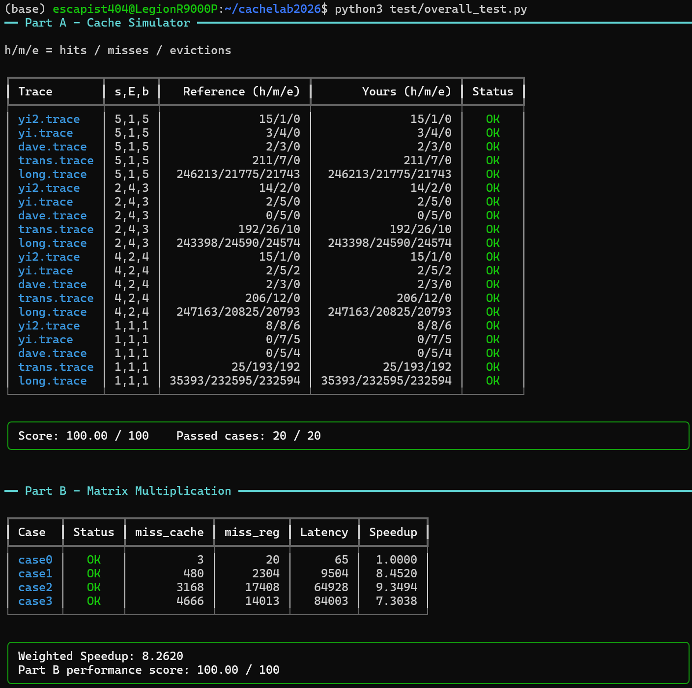
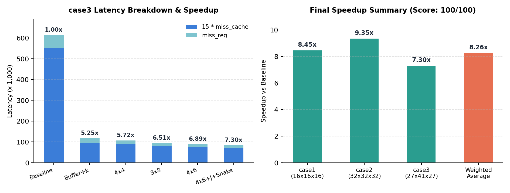
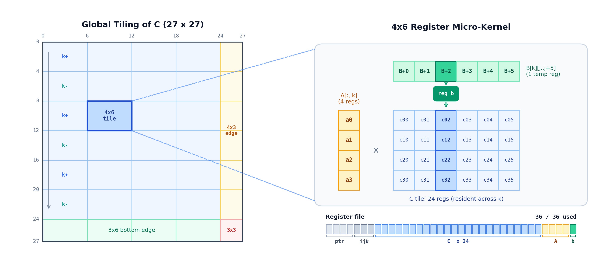

# CacheLab 报告

* 姓名：熊洋铭
* 学号：2025201731

| csim 分数（/100） | case1 speedup | case2 speedup | case3 speedup | weighted speedup | Part B 性能分（/100） |
| ---------------- | ------------- | ------------- | ------------- | ---------------- | ------------------- |
| 100.00 | 8.45 | 9.35 | 7.30 | 8.26 | 100.00 |

本地评测截图：

## Part A: csim.c

### 实现简述

本部分在 `csim.c` 中实现了通用缓存模拟器，支持任意合法的 $(s, E, b)$ 参数，采用写回（Write-Back）、写分配（Write-Allocate）与 LRU 替换策略。程序动态分配 $S \times E$（$S = 2^s$）个 `CacheLine` 结构体，每行保存 `valid`、`tag` 和时间戳 `lru`。对 64 位地址 `addr`，通过无符号右移提取组索引 $\text{set} = (\text{addr} \gg b) \bmod S$ 与标记位 $\text{tag} = \text{addr} \gg (s + b)$。

在写回和写分配策略下，读操作（`L`）与写操作（`S`）的缓存状态转移完全一致。每次访存只需遍历目标组内的 $E$ 行：若命中则更新 `lru = tick`；若未命中且组内有空行，则填入首个空行；若组已满，则淘汰 `lru` 最小的那一行。

### 亮点

程序使用 `fgets` 逐行读取，并用 `sscanf(line, " %c %lx", &op, &addr)` 解析。这样可以兼容带或不带 `0x` 的十六进制地址，同时跳过行末的寄存器号和 `size` 字段。代码在 `-Wall -std=c2x` 下零警告编译通过，20 组测试全部满分。

## Part B: gemm.cpp

### 亮点

本部分针对两级访存模型（即题设中的 $\text{latency} = 15 \times miss_{cache} + miss_{reg}$，Cache 为 $s=5, E=1, b=4$，容量 128 个 `int`，最多使用 36 个寄存器），主要采用了四项优化。第一是**寄存器分块**：把输出矩阵 `C` 的一小块留在寄存器里累加，算完再写回内存，内层 `k` 循环不读写 `C`，从而把 $miss_{reg}$ 降到朴素实现的 $1/4 \sim 1/6$。第二是**差异化分块选型**：`case1` 和 `case2` 的列宽是 4 的倍数，选用与 16 字节 Cache 块对齐的 `4 × 4` 分块；`case3`（$27 \times 41 \times 27$）不对齐，通过省出 `B` 的临时寄存器并展开内层，在 36 个寄存器内做出 `4 × 6` 分块。第三是**循环重排与蛇形遍历**：在 `case3` 中让 `j` 在外层、`i` 在内层以保住较大的 `B` 条带，并让 `k` 正反交替扫描，零开销复用留在 Cache 末端的数据。第四是**基于实测的 `buffer` 取舍**：通过实验对比证明，在本题参数下使用 `buffer` 打包反而增加总延迟，因此保留单趟 `k` 归约方案。

### 实现排序

1. `case3`
2. `case1`
3. `case2`

### case3

`case3`（$27 \times 41 \times 27$）最终结果为 $miss_{cache} = 4666$、$miss_{reg} = 14013$、$\text{Latency} = 84003$，加速比 **$7.3038\times$**。

| 优化阶段 | 分块与遍历策略 | $miss_{cache}$ | $miss_{reg}$ | Latency | Speedup |
| :--- | :--- | :---: | :---: | :---: | :---: |
| Baseline | 朴素 `i -> j -> k` | 36869 | 60507 | 613542 | 1.0000 |
| Stage 1 | `4 × 4` 主块 + 分块边角 | 6072 | 16227 | 107307 | 5.7176 |
| Stage 2 | `buffer` 打包 `B` + `k` 分 3 段 | 6379 | 21195 | 116880 | 5.2493 |
| Stage 3 | `4 × 6` 极限寄存器分块 | 5003 | 14013 | 89058 | 6.8892 |
| Stage 4 | `4 × 6` + `j` 外层 `i` 内层 + 蛇形 `k` | 4666 | 14013 | 84003 | 7.3038 |

`case3` 的列宽 $p = 27$ 不是 4 的倍数，导致读取 `B` 时经常跨过两个 Cache 块。为了进一步减少访存，我将 `B` 改成用 1 个临时寄存器 `b` 边读边算，并展开内层乘加。这样主块恰好占用 36 个寄存器（4 个指针、3 个循环变量、24 个 `c[24]`、4 个 `a[4]` 和 1 个 `b`），实现了 `4 × 6` 分块。相比 `4 × 4`，每轮 `k` 的访存计算比从 $8/16$ 降到 $10/24$；边角剩余的 3 行和 3 列分别用 `4 × 3`、`3 × 6`、`3 × 3` 分块扫尾。我也实测了同样算 24 个 `C` 的 `3 × 8` 分块（$miss_{cache} = 5273$，加速比 $6.51\times$），因为它每轮要读 $3 + 8 = 11$ 个数且需要扫 9 趟 `B`，不如更方正的 `4 × 6`。

在循环顺序上，`B` 的一个条带（$41 \times 6$）大约占 82 个 Cache 块，几乎是 `A` 条带（$4 \times 41$，约 44 块）的两倍。因此我将 `j` 放在外层、`i` 放在内层，并让相邻 `i` 块的 `k` 交替正序（$0 \to n-1$）和倒序（$n-1 \to 0$）扫描。这样上一块算完留在 Cache 里的 `B` 末端数据，下一块一上来就能直接命中，不增加任何 $miss_{reg}$ 就省下了 337 次 $miss_{cache}$。我也试过把 `k` 分成 3 段并用 `buffer` 打包 `B`，但多出了 2 遍 `C` 的读写，而且 `buffer` 依然会被 `A` 和 `C` 踢出 Cache，总延迟反而升到 `116880`，最终放弃了该方案。

### case1

`case1`（$16 \times 16 \times 16$）最终结果为 $miss_{cache} = 480$、$miss_{reg} = 2304$、$\text{Latency} = 9504$，加速比 **$8.4520\times$**。

`case1` 的行宽为 16（4 个 Cache 块），采用 `4 × 4` 分块正好与 Cache 行对齐，每次读 `B` 的 4 个数都落在同一个块内。如果改用 `4 × 6`，虽然 $miss_{reg}$ 降到 `2048`，但跨块导致 $miss_{cache}$ 涨到 `590`（加速比掉到 $7.37\times$），因此保留 `4 × 4`。此外，因为每个矩阵只有 256 个 `int`（2 倍 Cache 大小），我在 `k` 交替扫描的基础上，让 `j` 也按 `i` 的奇偶左右交替扫描（二维蛇形），在转向时复用 `A` 和 `B` 留在 Cache 里的末端块，使 $miss_{cache}$ 从 `496` 降到 `480`。

### case2

`case2`（$32 \times 32 \times 32$）最终结果为 $miss_{cache} = 3168$、$miss_{reg} = 17408$、$\text{Latency} = 64928$，加速比 **$9.3494\times$**。

`case2` 同样采用与 4 对齐行宽匹配的 `4 × 4` 分块，把 $miss_{reg}$ 降到了 $65536/4 + 1024 = 17408$。在此基础上，让相邻 `j` 子块的 `k` 交替正反扫描，将 $miss_{cache}$ 从 `3200` 降到了 `3168`。我也测试过二维 `j` 蛇形，但由于 `4 × 32` 的条带恰好占满整个 128-`int` Cache，换行时 `B` 末端块已经全部被踢出，二维蛇形反而多了 16 次缺失，所以最终采用一维蛇形 `k`。

## 感悟

这次实验让我直观体会到：理论上的最优指标，放到具体硬件参数下未必是最优解。比如 `4 × 6` 的访存计算比优于 `4 × 4`，但在 4 对齐的矩阵上破坏了 Cache 行对齐反而变慢；`buffer` 打包虽然能重排数据，但在小尺寸和直接映射下抵不过 `C` 反复读写的开销。反而是顺应局部性的蛇形遍历，不花任何额外代价就稳定降低了三个 case 的缺失率。

## 参考的重要资料

本实验参考了 Randal E. Bryant 与 David R. O'Hallaron 所著《Computer Systems: A Programmer's Perspective (CS:APP3e)》CacheLab 相关章节（[https://csapp.cs.cmu.edu/](https://csapp.cs.cmu.edu/)），以及本实验仓库文档 [README.md](../README.md) 和 [demo.cpp](../demo.cpp)。
